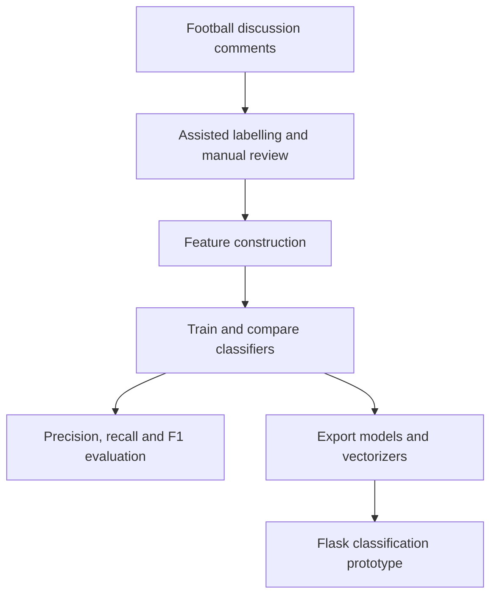

# Fair Play

A BSc Computer Science project exploring automated detection of harmful language in football discussion.

## Purpose

Abusive and harmful comments can remain visible while they wait for human moderation. I wanted to explore whether automated classification could support a faster response and reduce exposure, particularly for young, impressionable readers. The experiments evaluate classification quality; they do not measure moderation speed or demonstrate reduced harm in deployment.

## Design



I collected 19,282 comments from r/soccer across 13 discussion threads over four weeks. Of these, 3,131 were labelled harmful. The research compared Logistic Regression, Random Forest and XGBoost, with feature experiments including TF-IDF, n-grams, stemming, Word2Vec, lexical features, topic modelling and profanity counts.

## Repository guide

- `model/initial_labelling_model.ipynb`: initial labelling work.
- `model/logistic_regression.ipynb`, `model/random_forest.ipynb`, `model/XGBoost.ipynb`: model experiments.
- `model/data.csv`: research dataset. It can contain offensive text.
- `api_script/reddit.py`: historical collection script. Inspect and configure it before use; Reddit credentials and access are not required to run the saved-model prototype.
- `public/app.py`: Flask app with templates and saved artefacts alongside it.
- `public/templates/`, `public/static/`: browser interface and assets.
- `public/*_model_and_vectorizers.pkl`: saved model/vectorizer bundles.
- `public/requirements.txt`: historical environment snapshot.
- Root `app.py`: duplicate prototype; the runnable layout is under `public/`.

## Run the saved-model prototype locally

Use a separate virtual environment. The historical requirements contain Windows-specific and unrelated notebook dependencies; they are not a portable deployment lockfile. Start with Python 3.11 and the core versions listed below, then resolve any compatibility warnings against the saved artefacts.

```sh
git clone https://github.com/zakplum/final-year-project.git
cd final-year-project
python -m venv .venv
```

Activate the environment:

```sh
# Windows PowerShell
.venv\Scripts\Activate.ps1
# macOS / Linux
source .venv/bin/activate
```

```sh
python -m pip install Flask==3.0.3 Flask-Cors==4.0.0 joblib==1.3.2 numpy==1.26.1 scipy==1.11.3 scikit-learn==1.3.2 xgboost==2.0.3
cd public
python app.py
```

Open `http://127.0.0.1:5000`. Run from `public/` because the app loads the `.pkl` files from its working directory. Load only model artefacts you trust: pickle/joblib deserialisation can execute code. The development server uses debug mode and is intended for local exploration.

### API

`POST /classify` accepts a JSON object containing `comment` and returns labels from each classifier:

```json
{"comment": "An example football comment"}
```

Response keys are `Random Forest`, `Logistic Regression` and `XGBoost`; values are `Harmful` or `Non-harmful`.

## Findings

Reported harmful-class results from the dissertation’s feature-comparison tables:

| Feature set | Model | Precision | Recall | F1 |
|---|---|---:|---:|---:|
| TF-IDF baseline | Logistic Regression | 0.57 | 0.71 | 0.63 |
| TF-IDF baseline | Random Forest | 0.95 | 0.61 | 0.75 |
| TF-IDF baseline | XGBoost | 0.98 | 0.60 | 0.75 |
| Enhanced n-grams, stemming and profanity count | Each of the three models, as reported | 0.98 | 0.70 | 0.82 |

The abstract separately reports 0.99 precision for Logistic Regression; this table uses the feature-comparison results consistently. More elaborate combined features underperformed the TF-IDF baseline. The imbalanced labels made accuracy alone inadequate: recall around 0.70 still means many harmful comments were missed.

## Limits and next steps

The dataset comes from one community and labels involve judgement. These figures describe dissertation experiments, not production moderation performance.

The Flask prototype currently appends a constant `1` feature after word and character vectorisation. This does not recreate a training-time profanity count. Before treating its predictions as validated, consolidate training and inference preprocessing into a shared pipeline, confirm label mappings and artefact compatibility, and evaluate on held-out data. The documented environment has not been freshly reproduced as part of this README update.

Production use would also require input validation, appropriate CORS settings, logging that avoids retaining submitted comments, evaluation across communities and monitoring of harmful content missed by the model.

[Portfolio case study and recorded experiment explorer](https://zak-portfolio-sable.vercel.app/projects/fair-play/)
